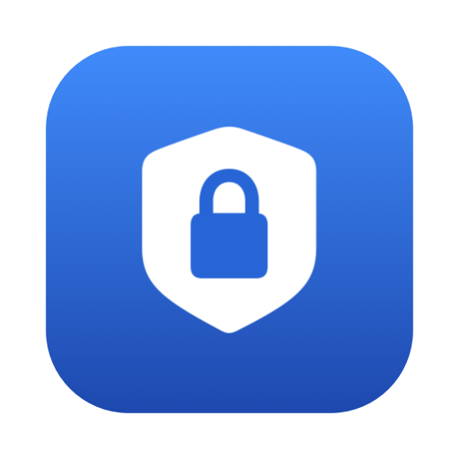

# Gatehouse

**Let your AI agents sign in to the websites you choose, without ever seeing your passwords.**

Gatehouse is a free, open-source Mac app for people who use AI agents such as Claude Code, Codex or Claude Desktop. You give it the logins your agents may use (your school's Moodle, a supplier portal, a library account) and switch on which agent may use which. When an agent needs to sign in, Gatehouse types the password into its own hidden browser and hands the agent the signed-in page. The agent never gets the password, and can only sign in where you've said yes.

It also works when you're away: a scheduled task can sign in at 3am without asking you. You're only needed if a website shows a CAPTCHA or texts you a code.

> **Status: 0.3.0, early.** Works on macOS 14 or later. Tested with Claude Code, Codex and Claude Desktop. Some websites need a small tweak to sign in; see [Troubleshooting](#when-a-website-doesnt-sign-in).

## Install

1. Download **Gatehouse.zip** from the [latest release](https://github.com/Quentin-Gigon/gatehouse/releases/latest) and double-click it.
2. Drag **Gatehouse** into your **Applications** folder and open it.
   macOS may say it "can't be checked for malicious software", because this free app isn't signed with a paid Apple developer account. Open **System Settings › Privacy & Security**, scroll down, and click **Open Anyway**. You only need to do this once.
3. Click **Set Up Gatehouse** and enter your Mac password. Setup takes a few minutes.

That's it. Gatehouse lives in the menu bar (the shield icon) and starts with your Mac.

## Use it

1. **Connect your AI apps.** In **Agents**, click **Connect** next to Claude Code, Codex or Claude Desktop, then restart that app. (T3 Code uses the Claude Code and Codex connections.)
2. **Add websites.** In **Websites**, click **+** and fill in the sign-in page, your username and password. Or click **Import** to pick logins from Apple Passwords, Chrome, 1Password or Bitwarden.
3. **Say who may use each website.** Select a website and switch on the agents that may sign in to it.
4. **Ask your agent.** For example: *"Use the gatehouse tools to sign in to Moodle and list this week's assignments."*

Changing anything asks for your Mac password or Touch ID. That's on purpose: your agents run as you, but they don't know your password, so they can't give themselves access.

When a website shows a CAPTCHA, you get a notification. Click it, solve the check in the window that opens, and the agent carries on.

## What it protects, and what it doesn't

**Protected:**
- **Your passwords.** They sit in an encrypted vault that only Gatehouse's own hidden system user can open. Agents can't read the file, can't ask for it, and never see the password typed.
- **Who can sign in where.** Only you, with your Mac password, can give access. An agent can't grant itself anything.
- **Session cookies.** Agents can't copy them out through the browser tools.

**Not protected:**
- **What an agent does once signed in.** It can do anything that website lets you do. Only allow agents on accounts where you're comfortable with that, and keep your bank and main email out of it.
- **Sites that expose their login to page scripts.** A few websites make part of the login readable to the page itself, and a misbehaving agent could copy it. If you suspect misuse: disconnect the agent, then use the website's own "sign out everywhere".
- **Passkeys, "Sign in with Google/Apple", and codes sent by text or email.** Those need you. Codes from an authenticator app can be automated: add the setup key to the website in Gatehouse.

**Safari and computer use:** normally agents sign in inside Gatehouse's own hidden browser, which works whichever browser you use. For agents that control your screen in Safari, switch on **Also allow in Safari** for a website: the agent asks Gatehouse, and the Gatehouse app opens the sign-in page in Safari and types the login itself, so the agent still never sees the password. This needs the Accessibility permission (Gatehouse asks once) and the app running (it opens at login). It's weaker than the hidden browser, because the signed-in session then lives in your Safari, so it's off unless you turn it on per website.

## When a website doesn't sign in

Open the website in Gatehouse, click **Edit › Advanced**:

- **Button to click first:** for sites whose sign-in page starts with a "Sign in with email" button. Example for Goodreads: `button.authPortalSignInButton`.
- **Other websites used to sign in:** for sites that send you to a separate login domain, such as `login.microsoftonline.com`.
- **Only present when signed in:** something on the page that only exists once you're signed in. It makes success detection more reliable.

Still stuck? [Open an issue](https://github.com/Quentin-Gigon/gatehouse/issues) with the website and what the agent reported (never include your password).

## For developers

Gatehouse is a Python service (`src/gatehouse`) that runs as a hidden `_gatehouse` user under launchd, with a SwiftUI menu-bar app (`app/`) on top. Agents talk to it over MCP: one server for sign-in requests, plus the [Playwright MCP](https://github.com/microsoft/playwright-mcp) browser tool connected to a filtered DevTools relay.

- Command line instead of the app: `sudo deploy/macos/install.sh`, then `gatehouse-admin` and `gatehouse-connect`. See [docs/DEPLOYMENT.md](docs/DEPLOYMENT.md).
- Build the app: `app/build.sh` (Command Line Tools are enough). It produces `dist/Gatehouse.app`.
- Try it without installing: `./run-demo.sh`, which uses a local fake site.
- Tests: `uv venv --python 3.12 && uv pip install -e ".[dev]" && .venv/bin/python -m pytest`. They start a real Chromium against a synthetic login site. `tests/test_attacks.py` holds the attacks found in review.

Docs: [architecture](docs/ARCHITECTURE.md) · [threat model](docs/THREAT_MODEL.md) · [API](docs/API.md) · [import formats](docs/IMPORT.md) · [deployment](docs/DEPLOYMENT.md) · [security policy](SECURITY.md)

## License

Apache-2.0. All credentials in this repository are fake.
